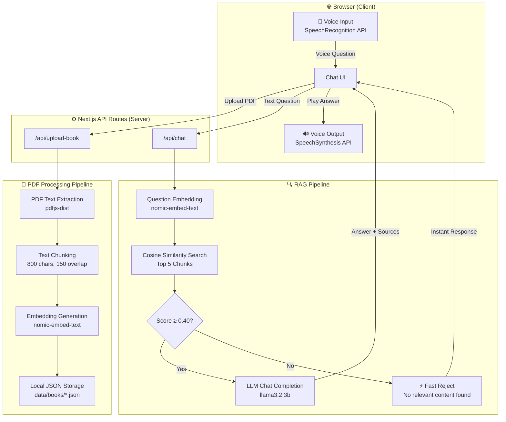

# DharmaAI — Voice Based Book Knowledge Assistant

> A **free, fully local, voice-enabled AI assistant** that lets you upload a PDF book, ask questions from its content, and receive answers through text and voice — powered entirely by local AI models with **zero API costs**.

[](https://nextjs.org/)
[](https://www.typescriptlang.org/)
[](https://tailwindcss.com/)
[](https://ollama.com/)

---

## Table of Contents

- [Problem Statement](#-problem-statement)
- [Key Features](#-key-features)
- [Tech Stack](#-tech-stack)
- [High-Level Architecture](#-high-level-architecture)
- [Application Flow](#-application-flow)
- [Setup Instructions](#-setup-instructions)
- [Environment Variables](#-environment-variables)
- [Folder Structure](#-folder-structure)
- [Demo Questions](#-demo-questions)
- [Learning Outcomes](#-learning-outcomes)
- [Future Improvements](#-future-improvements)
- [Disclaimer](#-disclaimer)

---

## 🧩 Problem Statement

Reading large books and PDFs is time-consuming. Users often want to quickly find answers to specific questions without manually scrolling through hundreds of pages. Traditional search only matches keywords, not meaning.

**DharmaAI solves this by:**

- Letting users **upload any PDF** and immediately start asking questions from its content.
- Using a **custom RAG (Retrieval-Augmented Generation) pipeline** to understand the *meaning* of questions and match them against relevant sections of the book.
- Providing **voice-based interaction** (speak your question, hear the answer) for a hands-free, accessible learning experience.
- Running **100% locally** — your books and conversations never leave your machine. No paid APIs, no cloud dependencies.

This project demonstrates a practical, portfolio-ready implementation of a **full-stack AI application** with RAG, embeddings, vector search, and voice UX.

---

## ✨ Key Features

| Feature | Description |
|---|---|
| 📄 **PDF Upload** | Upload any PDF book through the browser UI |
| 🔍 **PDF Text Extraction** | Extracts all text content from uploaded PDFs using `pdfjs-dist` |
| ✂️ **Smart Text Chunking** | Splits extracted text into overlapping 800-character chunks for better context retrieval |
| 🧮 **Embedding Generation** | Converts text chunks into vector embeddings using Ollama's `nomic-embed-text` model |
| 📦 **Local Vector Storage** | Stores chunks and their embeddings as JSON files — no external database required |
| 🔎 **Cosine Similarity Search** | Finds the top 5 most relevant chunks for any question using vector similarity |
| ⚡ **Smart Rejection** | Instantly rejects unrelated questions (similarity < 0.40) without wasting LLM compute |
| 💬 **Context-Based Answers** | Generates answers strictly from the uploaded book context using Ollama's `llama3.2:3b` |
| 📚 **Source Attribution** | Shows the exact text snippets used to generate each answer |
| 🎤 **Voice Input** | Speak your question using the browser's native Speech Recognition API |
| 🔊 **Voice Output** | Listen to the AI's answer using the browser's native Speech Synthesis API |
| 🎨 **Responsive Dark UI** | Modern, clean dark-mode interface built with Tailwind CSS |
| 🔒 **Fully Private** | Everything runs locally — your data never leaves your machine |

---

## 🛠️ Tech Stack

| Layer | Technology | Purpose |
|---|---|---|
| **Frontend** | Next.js 16, React 19, TypeScript | User interface, chat experience, and app routing |
| **Styling** | Tailwind CSS 4 | Responsive dark-mode UI design |
| **Backend** | Next.js API Routes (App Router) | Server-side PDF processing, RAG pipeline, and chat API |
| **Chat Model** | Ollama — `llama3.2:3b` | Local LLM for generating context-aware answers |
| **Embeddings** | Ollama — `nomic-embed-text` | Converts text and questions into 768-dimensional vectors |
| **PDF Parsing** | `pdfjs-dist` (via `pdf-parse`) | Extracts raw text from uploaded PDF files |
| **Vector Storage** | Local JSON files (`data/books/`) | Stores chunks and embedding vectors on disk |
| **Similarity Search** | Custom cosine similarity (TypeScript) | Finds the most relevant chunks for a given question |
| **Voice Input** | Web Speech API (`SpeechRecognition`) | Browser-native speech-to-text for voice questions |
| **Voice Output** | Web Speech API (`SpeechSynthesis`) | Browser-native text-to-speech for spoken answers |

---

## 🏗️ High-Level Architecture



---

## 🔄 Application Flow

### A. Uploading a PDF

1. The user selects a PDF file through the browser UI and clicks **Upload**.
2. The file is sent as `multipart/form-data` to the `/api/upload-book` API route.
3. The server validates the file type (must be PDF).

### B. Indexing the Book

4. The server extracts all text from every page of the PDF using `pdfjs-dist`.
5. The extracted text is cleaned and split into **overlapping chunks** (800 characters each, with 150 characters of overlap between consecutive chunks).
6. All chunks are sent to Ollama's `nomic-embed-text` model to generate **vector embeddings**.
7. The chunks and their embeddings are saved as a JSON file in the `data/books/` directory.

### C. Asking a Question

8. The user types a question in the chat input — or clicks the **microphone** button and speaks the question using the browser's Speech Recognition API.
9. The question is sent to the `/api/chat` API route along with the `bookId`.

### D. Searching Relevant Content

10. The server generates an embedding for the user's question using the same `nomic-embed-text` model.
11. It loads the stored book chunks and computes **cosine similarity** between the question embedding and every chunk embedding.
12. If the highest similarity score is below **0.40**, the question is instantly rejected as unrelated (no LLM call needed).
13. Otherwise, the **top 5 most relevant chunks** are selected.

### E. Generating an AI Answer

14. The top 5 chunks are injected into a system prompt as context.
15. The prompt and the user's question are sent to Ollama's `llama3.2:3b` chat model.
16. The model generates an answer based **strictly on the provided book context**.
17. The answer and the source chunks are returned to the browser.

### F. Playing Voice Response

18. The answer appears in the chat UI with an expandable **"View Sources"** section.
19. The user can click **"Play Audio"** to hear the answer spoken aloud using the browser's Speech Synthesis API.

---

## 🚀 Setup Instructions

### Prerequisites

- **Node.js** v18 or later — [Download](https://nodejs.org/)
- **Ollama** — [Download](https://ollama.com/) (free, local AI runtime)
- **Browser** — Chrome or Microsoft Edge recommended (for Web Speech API support)

### 1. Clone the Repository

```bash
git clone https://github.com/your-username/dharmaai-voice-book-assistant.git
cd dharmaai-voice-book-assistant
```

### 2. Install Dependencies

```bash
npm install
```

### 3. Install and Start Ollama

Download Ollama from [ollama.com](https://ollama.com/) and install it. Then pull the required models:

```bash
ollama pull llama3.2:3b
ollama pull nomic-embed-text
```

Make sure the Ollama server is running in the background (it starts automatically on most systems).

### 4. Configure Environment Variables

```bash
cp .env.local.example .env.local
```

The default values work out of the box:

```env
AI_PROVIDER=ollama
OLLAMA_BASE_URL=http://localhost:11434
OLLAMA_CHAT_MODEL=llama3.2:3b
OLLAMA_EMBEDDING_MODEL=nomic-embed-text
```

### 5. Run Locally

```bash
npm run dev
```

Open [http://localhost:3000](http://localhost:3000) in your browser.

### 6. Test the App

1. **Upload** a PDF file and wait for indexing to complete.
2. **Ask** a question in the chat box (or use the microphone).
3. **View Sources** — expand the source section in the AI's response to see which chunks were used.
4. **Play Audio** — click the speaker button to hear the answer.

---

## 🔐 Environment Variables

| Variable | Default | Description |
|---|---|---|
| `AI_PROVIDER` | `ollama` | AI provider to use (currently supports `ollama`) |
| `OLLAMA_BASE_URL` | `http://localhost:11434` | Base URL of the local Ollama server |
| `OLLAMA_CHAT_MODEL` | `llama3.2:3b` | Ollama model used for generating chat answers |
| `OLLAMA_EMBEDDING_MODEL` | `nomic-embed-text` | Ollama model used for generating text embeddings |

---

## 📁 Folder Structure

```text
dharmaai-voice-book-assistant/
├── app/
│   ├── api/
│   │   ├── upload-book/        # POST /api/upload-book — PDF upload, extraction, chunking, embedding
│   │   └── chat/               # POST /api/chat — Question embedding, similarity search, LLM answer
│   ├── layout.tsx              # Root layout with metadata and font configuration
│   ├── page.tsx                # Main page — orchestrates BookUpload and ChatWindow
│   └── globals.css             # Global styles and Tailwind imports
├── components/
│   ├── BookUpload.tsx           # PDF file upload form with progress feedback
│   ├── ChatWindow.tsx           # Chat interface with message list and input area
│   ├── MessageBubble.tsx        # Individual message bubble with source expansion and audio
│   ├── VoiceRecorder.tsx        # Microphone button using Web Speech Recognition API
│   └── AudioPlayer.tsx          # Play Audio button using Web Speech Synthesis API
├── lib/
│   ├── types.ts                 # TypeScript interfaces (RAGChunk, DocumentStore, ChatMessage, etc.)
│   └── pdf-extract.ts           # PDF text extraction utility using pdfjs-dist
├── data/
│   └── books/                   # Local JSON vector store (generated at runtime, gitignored)
├── public/                      # Static assets
├── .env.local.example           # Environment variable template
├── next.config.ts               # Next.js config (serverExternalPackages for pdfjs-dist)
├── package.json                 # Dependencies and scripts
├── tailwind.config.ts           # Tailwind CSS configuration
└── tsconfig.json                # TypeScript configuration
```

---

## 💡 Demo Questions

If you upload the included **Mahabharata Sample Knowledge Base PDF**, try asking:

| # | Question |
|---|---|
| 1 | Who are the Pandavas? |
| 2 | Why is Karna considered a tragic hero? |
| 3 | What lesson does Krishna teach Arjuna? |
| 4 | Why did the Kurukshetra war happen? |
| 5 | What is the role of Draupadi in the Mahabharata? |
| 6 | Compare Yudhishthira and Duryodhana. |
| 7 | What is the central theme of the Mahabharata? |

You can also test with **unrelated questions** (e.g., *"How to make a vanilla cake?"*) to see the smart rejection feature respond instantly instead of wasting compute time.

---

## 🎓 Learning Outcomes

Building this project teaches you:

| Concept | What You Learn |
|---|---|
| **RAG Fundamentals** | How Retrieval-Augmented Generation works end-to-end |
| **PDF Processing** | Extracting text from PDF documents programmatically |
| **Text Chunking** | Splitting documents into overlapping segments for better retrieval |
| **Embeddings** | Converting text into numerical vectors that capture semantic meaning |
| **Vector Similarity Search** | Using cosine similarity to find relevant content |
| **Local LLM Integration** | Connecting to Ollama for free, private AI inference |
| **Prompt Engineering** | Structuring system prompts with retrieved context |
| **Voice-Based UX** | Implementing speech-to-text and text-to-speech in the browser |
| **Next.js API Routes** | Building server-side endpoints with the App Router |
| **Full-Stack AI Architecture** | Designing a complete AI application from UI to inference |

---

## 🔮 Future Improvements

- [ ] 🔐 **Authentication** — Add user login and session management
- [ ] 📚 **Multiple Book Support** — Upload and switch between multiple books
- [ ] 💾 **Chat History** — Persist conversations across sessions
- [ ] 🗄️ **Vector Database** — Replace JSON storage with a proper vector DB (e.g., ChromaDB, Qdrant)
- [ ] 🌊 **Streaming Responses** — Stream LLM output token-by-token for faster perceived response
- [ ] 🐳 **Docker Deployment** — Containerize the app for one-command setup
- [ ] ☁️ **Cloud Deployment** — Deploy to Vercel/Railway with remote Ollama or cloud LLM
- [ ] 👤 **User Accounts** — Support multiple users with separate book libraries
- [ ] 📑 **Better Citations** — Show page numbers and highlighted excerpts in sources
- [ ] 🧠 **Advanced RAG** — Implement hybrid search, re-ranking, and query expansion
- [ ] 🌍 **Multilingual Voice** — Support voice input/output in multiple languages
- [ ] 📊 **Analytics Dashboard** — Track questions asked, topics explored, and usage patterns

---

## ⚠️ Disclaimer

This project is built for **learning and educational purposes**. It demonstrates how to build a RAG-based AI assistant with voice capabilities using modern web technologies.

- Uploaded book content should only be used if the user has **legal permission** or the content is in the **public domain**.
- The AI-generated answers are based on the uploaded content and may not always be accurate. Always verify critical information from the original source.
- This project does not collect, transmit, or store any data externally — everything runs locally on your machine.

---

<p align="center">
  Built with ❤️ for learning AI, RAG, and full-stack development.
</p>
