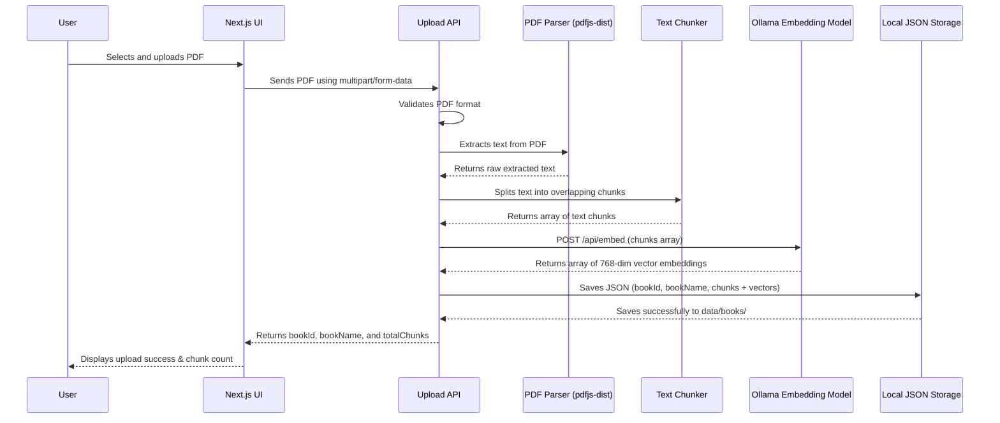
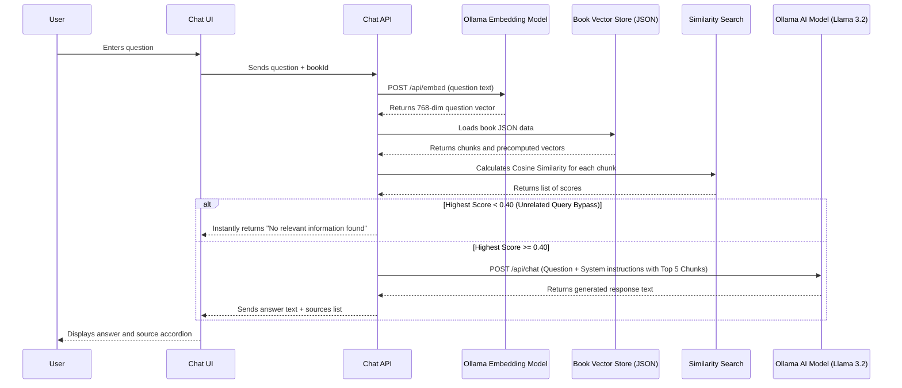
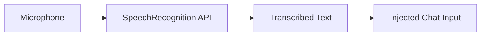
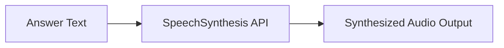
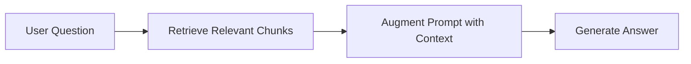

# DharmaAI Architecture and Internal Working

This document is a learner-friendly guide to the internal workings of **DharmaAI**. It explains how the system operates step-by-step, from file upload to similarity search and voice-based question answering.

---

## 1. Purpose of this Document

This document is designed to help students, developers, and AI learners understand how a local **Retrieval-Augmented Generation (RAG)** application is built from scratch. It explains the system components, data flows, search mathematics, prompt construction, and browser-native voice integrations.

---

## 2. System Overview

DharmaAI consists of the following key architectural blocks:

1. **Frontend UI (Next.js & React):** A responsive interface built with Tailwind CSS, supporting interactive chat bubbles, PDF upload drag-and-drop, and expandable "View Sources" details.
2. **Upload API (`/api/upload-book`):** A backend route that handles file validation, parses PDFs into raw text, segments the text into overlapping chunks, and creates vectors.
3. **PDF Text Extraction:** A server-side utility utilizing `pdfjs-dist` to read text layers from uploaded files.
4. **Text Chunking:** A smart utility that splits large texts into overlapping segments (800 characters, 150 characters overlap) so context remains unbroken.
5. **Embedding Generation:** A call to a local **Ollama** server using the `nomic-embed-text` model to turn text chunks into 768-dimensional numerical vectors.
6. **Vector/Local Storage:** Storing the processed chunks and embedding vectors in local JSON files inside the `data/books/` directory (no external databases needed).
7. **Chat API (`/api/chat`):** A backend route that receives user questions, embeds them, calculates similarity scores, and queries the LLM.
8. **Similarity Search:** A TypeScript implementation of **Cosine Similarity** to compare question vectors with stored chunk vectors.
9. **AI Response Generation:** Injects retrieved context snippets into a custom system prompt and queries local Ollama model (`llama3.2:3b`) to get a contextual answer.
10. **Voice Input:** Captured in real-time by the browser's native `SpeechRecognition` Web API.
11. **Voice Output:** Synthesized and played aloud by the browser's native `SpeechSynthesis` Web API.

---

## 3. Full System Architecture Diagram

This flowchart outlines the complete path of data from the User's input down to the local storage and local model inference:

```mermaid
flowchart TD
    User[User] --> UI[Next.js Frontend]
    UI --> UploadAPI[/api/upload-book]
    UploadAPI --> PDF[PDF Text Extraction]
    PDF --> Chunking[Text Chunking]
    Chunking --> Embedding[Embedding Generation]
    Embedding --> Store[Local Vector Store / Data Storage]
    
    UI --> ChatAPI[/api/chat]
    ChatAPI --> QueryEmbedding[Question Embedding]
    QueryEmbedding --> Search[Similarity Search]
    Search --> Context[Relevant Book Chunks]
    Context --> LLM[AI Model]
    LLM --> Answer[Answer Response]
    Answer --> UI
    
    User --> VoiceInput[Voice Input]
    VoiceInput --> UI
    UI --> VoiceOutput[Voice Output]
```

---

## 4. PDF Upload and Indexing Flow

When a user uploads a PDF file, the server runs a data ingestion pipeline to convert the static document into a searchable vector index.

### Step-by-Step Flow
1. **Send PDF:** The browser packages the file as `multipart/form-data` and POSTs it to `/api/upload-book`.
2. **File Validation:** The server verifies the file format is `application/pdf`.
3. **Text Extraction:** The server extracts text from all PDF pages.
4. **Text Chunking:** The text is split into small overlapping blocks.
5. **Embedding Generation:** The server requests vectors from local Ollama (`nomic-embed-text`) for all chunks in a single request.
6. **Local Storage:** The server writes the JSON payload containing the book name, ID, text chunks, and embedding arrays onto the disk under `data/books/[bookId].json`.
7. **Acknowledgement:** The server returns the unique `bookId`, `bookName`, and the `totalChunks` count to the React frontend.

### Sequence Diagram


---

## 5. Chat and Search Flow

Once a book has been successfully indexed, the user can ask questions about its content.

### Step-by-Step Flow
1. **Enter Question:** The user inputs a question (e.g., *"Why is Karna considered a tragic hero?"*).
2. **Post Request:** The frontend sends a POST request with the `message` and the active `bookId` to `/api/chat`.
3. **Embed Question:** The server calls local Ollama (`nomic-embed-text`) to generate a vector representation of the user's question.
4. **Load JSON Index:** The server reads the index file `data/books/[bookId].json` from disk.
5. **Compute Similarities:** For every text chunk in the book, the server calculates the **cosine similarity** score against the question vector.
6. **Smart Rejection Check (Bypass):** If the highest similarity score is **below 0.40**, the server aborts the LLM call immediately. It returns: *"I could not find any relevant information in the uploaded book context."* This avoids wasting CPU/GPU resources on irrelevant questions.
7. **Retrieve Top 5 Chunks:** If the score is $\ge$ 0.40, the server sorts chunks in descending order of similarity and selects the top 5 match text blocks.
8. **Prompt Construction:** The server builds a prompt injecting the matching text blocks into the system instructions.
9. **Ollama LLM Call:** The server POSTs the prompt to local Ollama (`llama3.2:3b`) using `/api/chat` with `stream: false`.
10. **Return Result:** The server receives the text response and sends it back to the client, along with the top 5 raw text chunks as `sources`.

### Sequence Diagram


---

## 6. Understanding Embeddings Simply

A computer cannot read English words and understand their meaning directly. Computers are only good at mathematics and numbers. **Embeddings** bridge this gap by converting English text into lists of numbers (vectors).

- When a document is embedded, the words are converted into high-dimensional points. Similar ideas (e.g., *"crown"*, *"king"*, *"royal"*) are positioned close to each other in this mathematical space.
- Different concepts (e.g., *"crown"* and *"vanilla cake"*) are placed very far apart.

### Example Match
*   **Question:** *"Who is Karna?"*
*   **Book Chunk:** *"Karna was the son of Kunti and was known for loyalty, generosity, and his tragic life allied with the Kauravas."*
*   **Result:** The embedding model outputs vector math where these two sentences have very similar profiles. The system finds this chunk because the question vector matches the chunk vector's coordinates closely.

---

## 7. Understanding Similarity Search

To find the best context without an expensive cloud database, DharmaAI computes **Cosine Similarity** locally on your computer. 

Cosine similarity calculates the angle between two vectors (the question vector and the chunk vector).
- If the angle is $0^\circ$ (the vectors point in the exact same direction), the similarity score is **1.0** (perfect match).
- If the angle is $90^\circ$ (perpendicular vectors), the similarity score is **0.0** (no match/unrelated).

By computing similarity across all chunks, sorting them, and selecting the top 5, the app dynamically extracts the most relevant pages of the book to guide the AI's answer.

---

## 8. Prompt Construction

When we call the AI model, we don't just send the question. We "augment" it by packing the system instruction and retrieved book chunks together into the prompt. 

### Example Constructed Prompt
```text
[System Instructions]
You are DharmaAI, a helpful book knowledge assistant.
Answer the user's question based strictly on the uploaded book context provided below.
If the answer is not found in the uploaded book context, clearly say "I could not find the answer in the uploaded book."
Explain in simple English. For spiritual or epic content, explain respectfully and clearly.

Context:
--- Snippet 1 ---
Karna was the son of Kunti. He was a brave and generous warrior allied with the Kauravas.
--- Snippet 2 ---
The rivalry between Pandavas and Kauravas led to the massive Kurukshetra war...

[User Message]
Why is Karna considered a tragic hero?
```

### Why we do this
1. **Reduces Hallucination:** The model is told to only answer using the `Context` section.
2. **Solves Knowledge Limitations:** The local model doesn't need to know the book beforehand; it reads the relevant book snippets from the prompt dynamically.

---

## 9. Voice Input Flow

DharmaAI uses the **HTML5 Web Speech API** to enable voice questions directly in the browser without any server-side audio transcription costs.



1. **Microphone Capture:** The user clicks the microphone button, initiating the `webkitSpeechRecognition` engine.
2. **Local Processing:** The browser records, processes, and transcribes speech locally in real-time.
3. **State Sync:** The resulting text is captured by the `onTranscription` callback and appended to the text input box.
4. **Transmission:** The user clicks Send (or speaks continuously) and the text is processed as a standard search query.

---

## 10. Voice Output Flow

To respond with voice, DharmaAI utilizes browser-native **Text-to-Speech (TTS)**:



1. **Speak Event:** The user clicks the **"Play Audio"** button inside the AI response message bubble.
2. **Synthesis:** The browser reads the text answer and uses the host operating system's built-in text-to-speech voice engines (`window.speechSynthesis`).
3. **Playback:** The audio plays back smoothly through the user's speakers, all handled locally inside the browser client.

---

## 11. Internal Data Example

This is a real-world example of how a book's vectors are serialized on disk in `data/books/[bookId].json`:

```json
{
  "bookId": "book-1783134235113-uw0owfs",
  "bookName": "DharmaAI_Mahabharata_Sample_Knowledge_Base.pdf",
  "chunks": [
    {
      "id": "chunk-0",
      "text": "DharmaAI Mahabharata Sample - Page 1 DharmaAI Mahabharata Sample Knowledge Base A simple original educational PDF for testing...",
      "embedding": [
        0.01093214,
        0.08885894,
        -0.13293552,
        -0.03433089,
        0.04702518,
        -0.02816948,
        0.03862813,
        -0.02446579
      ]
    }
  ]
}
```

---

## 12. Why This is Called RAG

RAG stands for **Retrieval-Augmented Generation**:



1. **Retrieve:** Find the matching pages/chunks inside the local vector JSON storage.
2. **Augment:** Insert those chunks into the prompt context.
3. **Generate:** Generate the final answer using the LLM.

---

## 13. Limitations

- **Text Extraction Bounds:** The quality of the RAG search depends on the text layer quality in the PDF. Images or scanned books without text layers (OCR) cannot be parsed.
- **Local Compute Speeds:** Local inference speeds depend on CPU/GPU capabilities. Ollama response times can take between 10 seconds to 1 minute depending on the host hardware.
- **Microphone Support:** The Speech Recognition API requires browser support (Chrome, Safari, and Microsoft Edge provide full support; Firefox has limited default support).
- **Scale:** Storing embeddings as raw JSON files is ideal for small/medium books. For large libraries, a dedicated vector database should be used.

---

## 14. Future Architecture Improvements

- **Dedicated Vector DB:** Migrating local JSON files to a local database like **ChromaDB** or **SQLite Vector extension**.
- **Server-Side OCR:** Integrating `tesseract.js` on the server to handle scanned books and image PDFs.
- **Citations:** Pinpointing precise page numbers and coordinates for retrieved snippets.
- **Multi-Book Libraries:** Allowing users to choose which book(s) in their database are currently active.
- **Authentication:** Supporting multiple users with secure isolated libraries.
- **Streaming Response:** Implementing token streaming from the chat route for faster perceived typing feedback.
